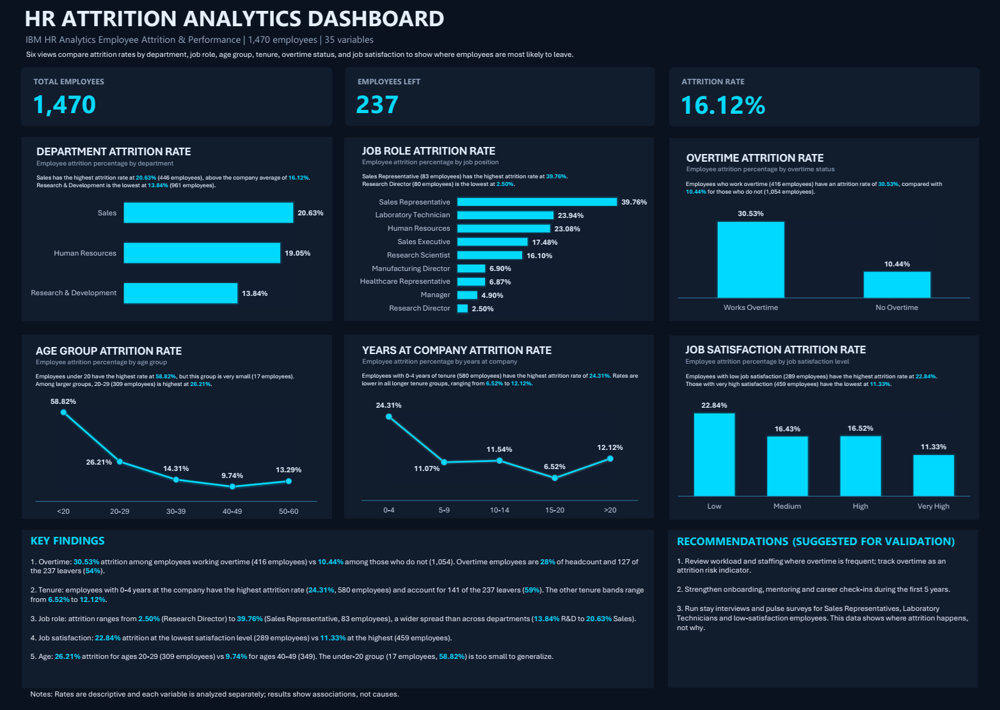
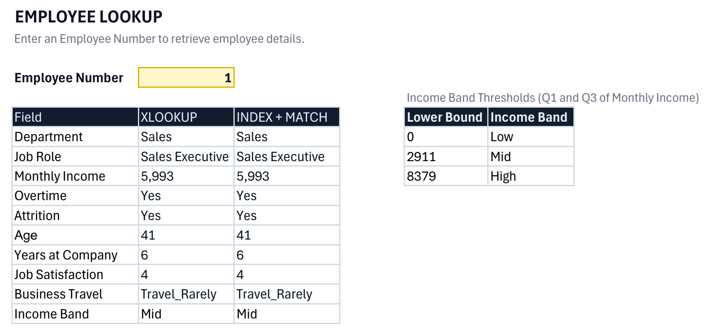

# HR Attrition Analysis Dashboard (Excel)

This project explores employee attrition using the IBM HR Analytics Employee Attrition & Performance dataset. I used Excel Tables, PivotTables, Group Field, and standard formulas to analyze employee attrition patterns and bring the results together in a static dashboard.



## Business Problem

Employee turnover can affect different departments and job roles in different ways. For HR, understanding where attrition is highest is a useful starting point when deciding where retention efforts may be needed.

This project looks at the following questions:

1. What is the overall employee attrition rate?
2. How does attrition vary across departments and job roles?
3. Are there differences in attrition across age groups and years at the company?
4. How does attrition compare between employees who work overtime and those who do not?
5. Is there a difference in attrition across job satisfaction levels?
6. What patterns stand out, and what could HR consider doing in response?

## Dataset

- **Source:** IBM HR Analytics Employee Attrition & Performance, a fictional dataset created by IBM data scientists (publicly available on Kaggle)
- **Records:** 1,470 employees
- **Columns:** 35
- **Target variable:** `Attrition` (Yes/No)

## Methodology

The analysis was carried out in several steps:

1. **Data preparation:** I kept the original dataset unchanged in `Raw_Data` and created a working copy in `Data`, which I converted into an Excel Table named `HRData`.
2. **Helper column:** I added `AttritionFlag`, which returns 1 when `Attrition` is "Yes" and 0 otherwise. This is the only helper column added to the table. Using its average in a PivotTable makes it possible to calculate the attrition rate.
3. **PivotTables:** I created PivotTables to summarize headcount and attrition rates across departments, job roles, age groups, years at the company, overtime status, and job satisfaction.
4. **Grouping:** Age and tenure categories were created using the PivotTable Group Field feature, without additional formulas. The groups are: age <20, 20-29, 30-39, 40-49, 50-60; and tenure 0-4, 5-9, 10-14, 15-20, >20 years.
5. **Charts:** I built standard Excel charts using the PivotTable summary ranges rather than PivotCharts.
6. **KPI cards:** The dashboard includes total employees, employees who left, and the overall attrition rate. These figures are calculated using Excel formulas.
7. **Dashboard:** I brought the results together on a single static worksheet, with six charts, three KPI cards, key findings, and recommendations. The dashboard does not use slicers.

## Key Findings

The figures below are taken from the workbook's PivotTables. Leaver counts for overtime and tenure are derived from headcount multiplied by the attrition rate.

- **Overall attrition:** 237 out of 1,470 employees left the company, resulting in an attrition rate of 16.12%.
- **Overtime:** Employees who work overtime have an attrition rate of 30.53% (416 employees), compared with 10.44% among employees who do not (1,054 employees). Although overtime employees account for 28% of the workforce, they represent 127 of the 237 leavers (54%).
- **Tenure:** Employees with 0-4 years at the company have the highest attrition rate at 24.31% (580 employees). This group accounts for 141 of the 237 leavers (59%). The other tenure groups have attrition rates ranging from 6.52% to 12.12%.
- **Job role:** Attrition varies considerably by job role, from 2.50% for Research Directors to 39.76% for Sales Representatives (83 employees). This range is wider than the difference across departments, where attrition ranges from 13.84% in Research & Development to 20.63% in Sales.
- **Job satisfaction:** The attrition rate is 22.84% among employees with the lowest job satisfaction level (289 employees), compared with 11.33% among those with the highest level (459 employees).
- **Age:** Employees aged 20-29 have an attrition rate of 26.21% (309 employees), while the rate for employees aged 40-49 is 9.74% (349 employees). The under-20 group has a much higher rate of 58.82%, but it includes only 17 employees, so the result should be interpreted with caution.

## Recommendations (suggested for validation)

The patterns in this analysis point to a few areas HR could look into further. These recommendations are suggestions for follow-up, not proven explanations for why employees leave.

1. Review workload and staffing in areas where overtime is frequent, and consider tracking overtime as a potential attrition risk indicator.
2. Strengthen onboarding, mentoring, and career check-ins for employees during their first five years at the company.
3. Conduct stay interviews and pulse surveys with Sales Representatives, Laboratory Technicians, and employees reporting low job satisfaction. The dataset shows where attrition is higher, but it does not explain the reasons behind it.

## Supporting Tool: Employee Lookup

The workbook also includes a small employee lookup sheet for a common HR task: finding employee details using an Employee Number.



- It uses **XLOOKUP** and **INDEX + MATCH** side by side to retrieve employee information. Both return the same results and are wrapped in `IFERROR` to display "Not found" when an ID cannot be matched.
- It also assigns an **Income Band** (Low / Mid / High) using an approximate-match XLOOKUP against a threshold table (`match_mode = -1`).
- The thresholds are based on the first and third quartiles of Monthly Income, calculated with `QUARTILE.INC` (2,911 and 8,379).
- The classification rule is: Low = below Q1, Mid = Q1 up to below Q3, and High = Q3 and above.
- The Employee Number input uses Data Validation.

Example formula:

```excel
=IFERROR(XLOOKUP(C10,$F$8:$F$10,$G$8:$G$10,"Not found",-1),"Not found")
```

This lookup sheet serves a separate purpose from the attrition analysis. Income Band is not used in any of the dashboard calculations.

## Excel Skills Demonstrated

Excel Tables, PivotTables, PivotTable Group Field, standard charts, XLOOKUP, INDEX + MATCH, IFERROR, QUARTILE.INC, Data Validation, and dashboard layout.

## Limitations

There are a few limitations to keep in mind when interpreting the results:

- Each variable was analyzed separately. No combined or multivariate analysis was performed.
- Results for smaller groups, such as employees under 20 (17 employees), may be unstable and should be interpreted with caution.
- The dataset is a snapshot and does not include a time dimension, so attrition trends over time cannot be analyzed.
- The findings show associations, not causes.
- The dashboard is static and does not include slicers or interactive filtering.

## Repository Structure

```text
hr-attrition-excel-dashboard/
├── README.md
├── HR_Attrition_Dashboard.xlsx
├── images/
│   ├── dashboard.png
│   └── employee_lookup.png
└── data/
    └── README.md
```

**Workbook sheets:** `Raw_Data`, `Data`, `Pivot`, `Dashboard`, `Employee_Lookup`.
